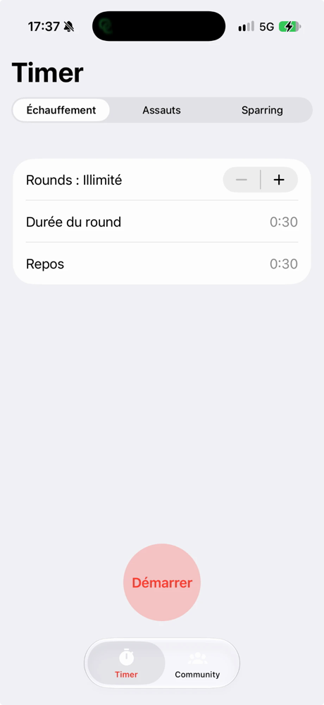
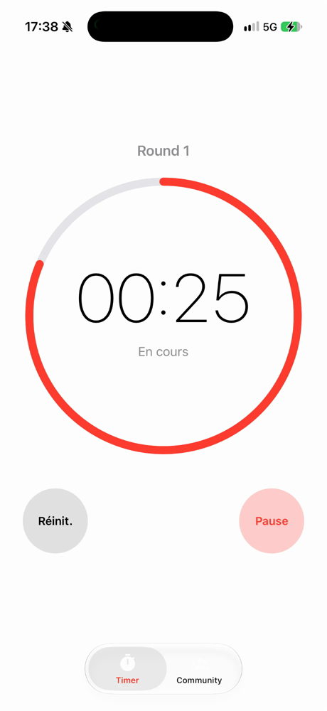

# Boxing Timer

A personal boxing round timer for iOS and Android, built with Expo and native UI components. It rings the bell, clacks the 10-second warning and keeps counting with the phone locked.

<p align="center">
  
  &nbsp;&nbsp;&nbsp;
  
</p>

## Features

- **Presets** — one tap fills the settings, which stay editable afterwards:
  | Preset | Rounds | Round | Rest |
  |---|---|---|---|
  | Échauffement | unlimited | 0:30 | 0:30 |
  | Assauts | unlimited | 1:30 | 0:35 |
  | Sparring | 12 | 3:00 | 1:00 |
- **Custom settings** — 1–100 rounds or unlimited, rounds and rest from 1 s to 5 min. Defaults: 3 × 3:00 with 1:00 rest. Settings are saved on the device.
- **Session screen** — large countdown inside a progress ring, red during rounds and green during rest, pulsing over the last 10 seconds.
- **Sounds and haptics** — a boxing bell at the start and at every phase change, a wooden clapper 10 seconds before the end of each round, and a vibration at the 10-second mark and at each phase change. Sounds play even in silent mode and mix over your music instead of stopping it.
- **Locked screen** — the timer keeps running and ringing with the phone locked:
  - iOS: a Live Activity on the lock screen and in the Dynamic Island, with a native countdown coloured by phase.
  - Android: a persistent notification with a countdown chronometer.
- **Accurate time** — phase ends are timestamps, so time spent in the background is caught up exactly instead of drifting.

The UI is in French.

## Getting started

Requirements: Node.js, Xcode (iOS) and/or Android Studio (Android). Expo Go is **not** supported: background audio, the Live Activity and the Android foreground service need native code, so the app runs as a development build.

```bash
npm install
```

### Development build

```bash
npm run ios        # build and run on a simulator or a plugged-in iPhone (add -- --device to pick one)
npm run android    # build and run on an emulator or a device
npm start          # later: start Metro for an already installed development build
```

### Standalone iPhone build

```bash
npm run release
```

Builds the Release configuration with the JavaScript bundle embedded and installs it on the plugged-in iPhone, so the app works without the Mac. With a free Apple account the signature expires after 7 days: plug the phone back in and run the command again. To sign the widget extension on a device, set your team ID in `app.json` under `expo.ios.appleTeamId`.

## Development

```bash
npm test           # timer state machine and lock-screen content (node:test)
npm run lint       # ESLint
npx tsc --noEmit   # type check
```

## Tech stack

- Expo SDK 58, React Native 0.88 (New Architecture), React 19 with the React Compiler, TypeScript
- Expo Router with native tabs, `@expo/ui` (SwiftUI on iOS, Jetpack Compose on Android) and NativeWind
- `expo-audio`, `expo-haptics`, `expo-keep-awake`, `react-native-svg`, `@legendapp/motion`
- Live Activity: a SwiftUI widget in `targets/live-activity` (via `@bacons/apple-targets`) driven by the local module `modules/live-activity`
- Android lock screen: the local Kotlin module `modules/session-notification`

The project layout and conventions are documented in [`.claude/CLAUDE.md`](.claude/CLAUDE.md).

## Credits

Sound credits are listed in [`assets/sounds/CREDITS.md`](assets/sounds/CREDITS.md). The clapper is a CC0 recording of wooden claves by SamuelGremaud on Freesound.

This app is for personal use and is not published on the App Store or Google Play.
